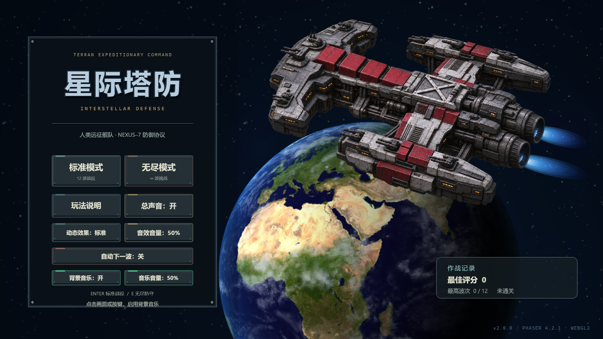
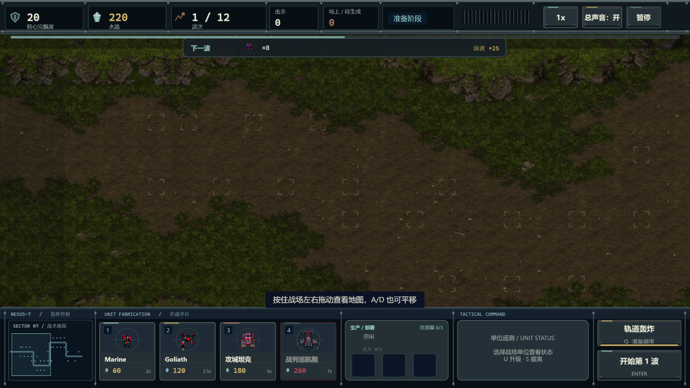
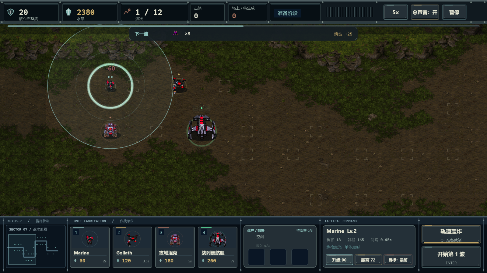
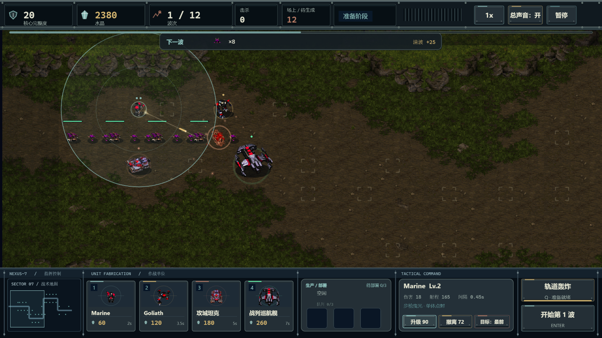
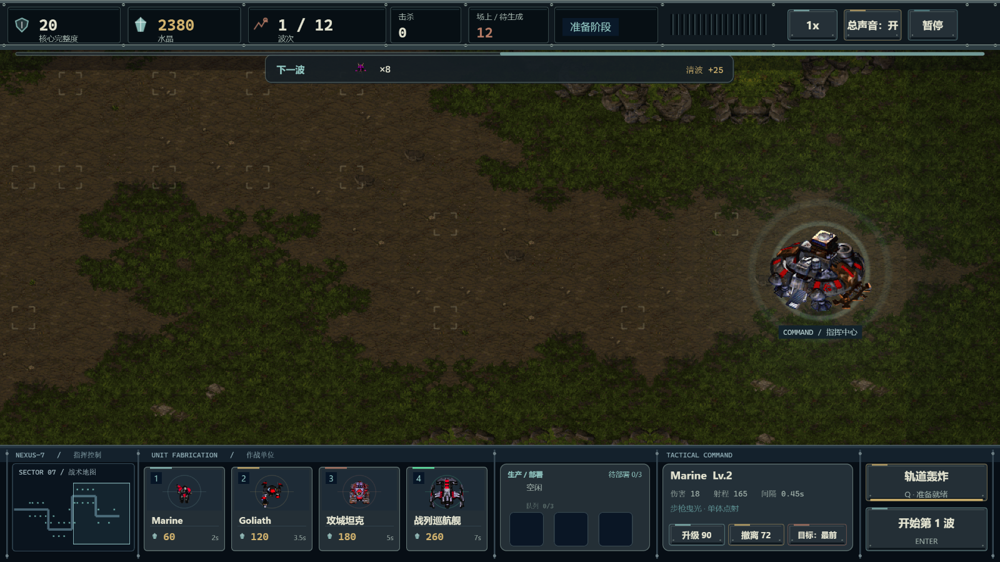
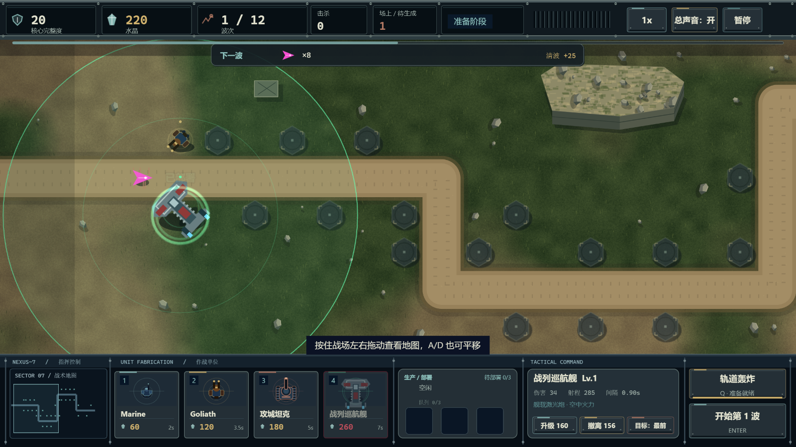
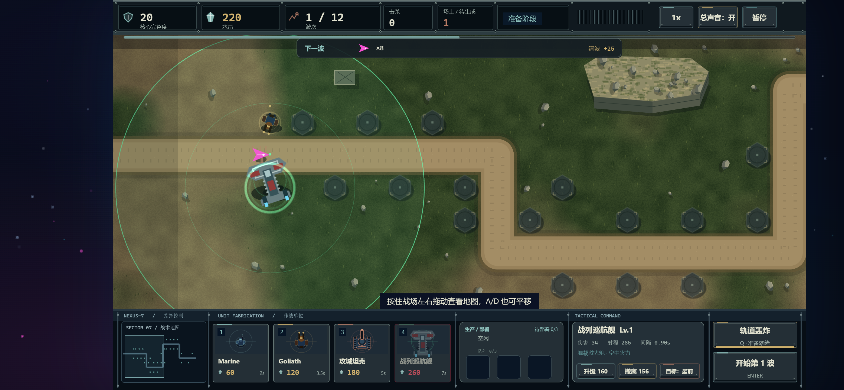

# 星际塔防 · Interstellar Defense

基于 **Phaser 4.2.1 + TypeScript + Vite 8** 的二维单机塔防练习项目。制造人族单位、部署防线、升级火力，守住指挥中心，抵挡12波虫族或挑战无尽模式。



[项目总结与后续关卡方向](docs/15-project-summary.md) · [需求登记](docs/00-requirement-process.md) · [实施与验证报告](docs/03-implementation-report.md)

## 启动

需要 Node.js 20.19+ 或22.12+、支持WebGL2的现代浏览器。

```bash
npm install
npm run dev
```

默认地址为 `http://127.0.0.1:5173/`，以终端实际输出为准。

```bash
npm test
npm run typecheck
npm run build
npm run preview
```

构建目录为 `dist/`，运行期无后端、无第三方网络请求。本地原版素材包会被Vite复制进本地构建，**公开部署前必须移除该包或换用已授权资源**；Git已忽略素材包和dist。

## 当前玩法

| 单位 | 制造水晶 | 制造时间 | 火力特点 |
| --- | ---: | ---: | --- |
| Marine 机枪兵 | 60 | 2秒 | 快速步枪点射与曳光 |
| Goliath 歌利亚 | 120 | 3.5秒 | 双管自动炮 |
| 攻城坦克 | 180 | 5秒 | 远距离范围重炮 |
| Battlecruiser 战列巡航舰 | 260 | 7秒 | 舰载激光炮远程支援 |

- 单生产线、制造队列3格、待部署3格；拖放部署，或先点待部署单位再点战场位置。
- 单位可升至3级；撤离返还60%已投入水晶。单位不会被敌人攻击，升级不改变模型尺寸。
- 标准12波、雷兽Boss及无尽模式；准备阶段不限时，支持1x–5x、暂停和自动下一波。
- 轨道轰炸：0.4秒预警、200点无视护甲范围伤害、30秒冷却。
- 2560×720双屏世界、32部署点；可拖动战场、使用方向键或小地图平移。顶部显示资源、波次与视角位置。
- 最高评分、最高波次与设置保存在localStorage；存储不可用时使用内存，无中局存档。

## 当前画面与音频

- **首页**：动态地球球面投影、独立云层与光照，透明战列舰、航行起伏与动态尾焰；银蓝标题与人类机械控制台。减少动态设置可冻结动画。
- **地图**：本地素材版采用星际一原始32px图块、CV5左右成对变体、ISOM草地/泥地连接与连续堆叠岩壁。已经替代随机透明拼片、几何高台和工业甲板。部署点为淡色角标，进入部署时高亮。
- **比例与动作**：Marine < Goliath < 坦克 < 战列舰；本地包提供16方向和虫族移动帧，按移动距离驱动，暂停时冻结。机枪兵连续开火不再累积向下偏移。
- **声音**：按钮悬停/确认、制造/升级/武器反馈与单位语音；歌利亚和战列舰缺少选中声音时回退Marine，并处理文件播放失败。
- **独立音量**：首页和暂停菜单可分别调音效音量、音乐音量，按100/75/50/25/0%循环并保存；总声音开关控制两路。调低音效不会压低音乐。
- **背景音乐**：36.92秒原创合成循环曲，首次真实点击或按键后开始；页面隐藏时暂停，主页显示播放状态和重试提示。不是星际原声。
- **清晰度**：1280×720逻辑界面，内部2560×1440渲染，保持16:9，画布外用动态星空填充。

## 最新截图

2026-11-07重新截取。地形与单位原版视觉来自本地可选素材包；公开仓库不包含该包。四兵种与战斗展示由验收脚本补充调试水晶/敌人，不能用截图判断实际开局经济与关卡平衡。

| 原生草地、泥地与岩壁 | 四兵种比例与部署 |
| --- | --- |
|  |  |

| 战斗效果 | 人族基地与右侧战区 |
| --- | --- |
|  |  |

| 缺本地包的程序化回退 | 小窗口横屏布局 |
| --- | --- |
|  |  |

## 操作

| 操作 | 键鼠 |
| --- | --- |
| 标准模式 / 无尽模式 | 菜单按钮 / Enter / E |
| 制造四兵种 | 制造卡 / 1、2、3、4 |
| 部署 | 拖放待部署单位；或先选单位再点部署点 |
| 平移视角 | 拖动战场 / A、D / ←、→ / 小地图 |
| 选中单位 | 点击已部署单位 |
| 升级 / 撤离 | 面板按钮 / U / S |
| 开始下一波 | 波次按钮 / Enter |
| 轨道轰炸 | 技能按钮 / Q，再点战场 |
| 暂停 / 继续 | 暂停按钮 / Space / Esc |
| 取消操作 | 右键 / Esc |
| 切换1x–5x | 速度按钮 / F |

## 本地素材与研究资源

原版图形、音效及社区源码缓存只在 `artifacts/starcraft1/` 和 `public/assets/sc-local/`，不提交、不公开分发。缺包时游戏使用程序化地形/单位与合成声音，效果与本地原版素材版不同。

```bash
python scripts/stage-starcraft-pack.py
```

需要已准备好的本地源文件和Pillow。阶段脚本包括单位方向/步态与地形提取。原生地图离线生成还需要本地scm-js源码缓存与tsx缓存；前置条件、执行方式和跳过提示见[原生地形重做说明](docs/14-classic-terrain-rebuild.md)。运行期只读取烘焙PNG，不载入地图编辑器。

| 资源 | 用途 |
| --- | --- |
| [scm-js](https://github.com/scm-js/scm-js)（MIT） | 地图编辑器研究与离线ISOM地形生成 |
| [ISOM地形说明](https://docs.scmjs.dev/chk/the-isometric-record-explained/) | 地形边缘、连接与岩壁堆叠规则 |
| [bwmapgfx](https://github.com/dada78641/bwmapgfx) | 本地原版地形图形数据参考 |
| [SC-Js社区项目](https://github.com/GiacomoVespo/starcraft-full-html5) | 地图和单位参考 |
| [菜单图片署名](public/assets/art/CREDITS.md) | NASA日图、云图及生成舰体出处 |

Phaser采用MIT许可；原版星际图形/声音权利归相应权利人所有，不因仓库代码同步而成为可公开分发的项目资源。项目合成音乐和中文TTS语音保存在public/audio。

## 工程结构与验证

- `src/domain/`：战斗、索敌、路径和计分纯TypeScript规则。
- `src/data/`：单位、波次、关卡；当前地图配置在 `level01.ts`。
- `src/scenes/`：Boot / Menu / Game / UI；固定步长模拟，UI通过EventBus通信。
- `src/entities/`、`src/ui/`、`src/render/`：单位视图、控制台、地形、首页和效果。
- `src/systems/`：音频与存档设置。
- `scripts/`：素材提取、离线地图布局与浏览器验证。

当前 **34项单元测试、类型检查与生产构建通过**。真实浏览器覆盖制造/部署、非法拖放、升级比例、移动帧暂停、双屏平移、缺包回退、声音失败回退和独立音量保存。机枪兵在1x/5x共200次中断后坐力后位置稳定；地图800个ISOM单元连接不匹配0，路线与部署点无高地交叉。

验收记录：[视觉与交互](artifacts/visual-overhaul-verification.json)、[地形连接](artifacts/classic-terrain-verification.json)、[音乐与独立音量](artifacts/music-playback-verification.json)、[动态首页与语音回退](artifacts/orbital-menu-verification.json)。

本轮未重跑完整12波及无尽平衡；音轨解码/进度验证不能替代扬声器实听；视觉质感仍以用户反馈为准。高地目前只作美术层次，没有高地伤害或遮挡规则。

## 后续关卡方向

先稳定首关画面与单位可读性，再拆出独立关卡配置和选择入口，逐关设计路线、部署点、敌人组合、资源和Boss节奏。完整平衡、中局存档、触控打磨和公开部署的可授权地形替代仍待后续工作。

更多文档：[项目总结](docs/15-project-summary.md)、[需求登记](docs/00-requirement-process.md)、[技术方案](docs/02-technical-design.md)、[实施报告](docs/03-implementation-report.md)、[协作规则](AGENTS.md)。
