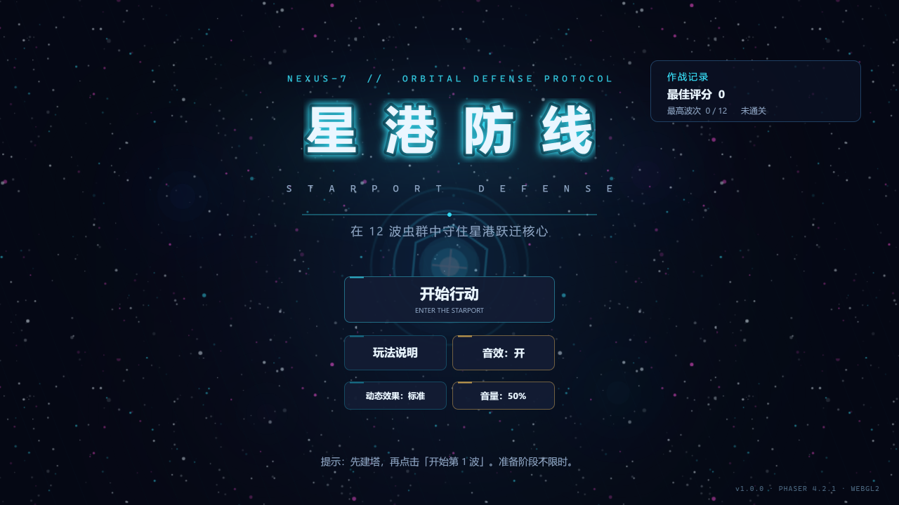
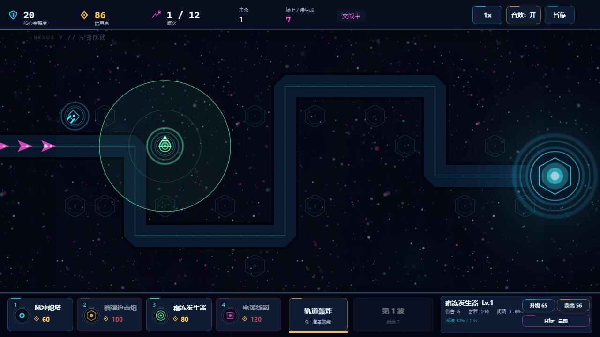
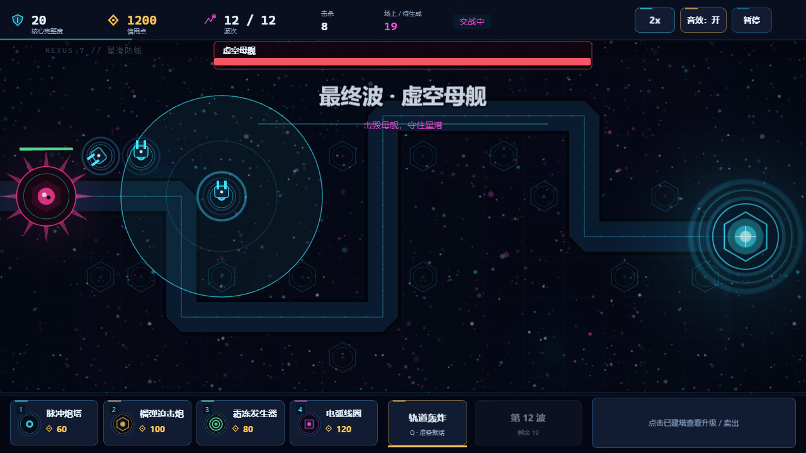
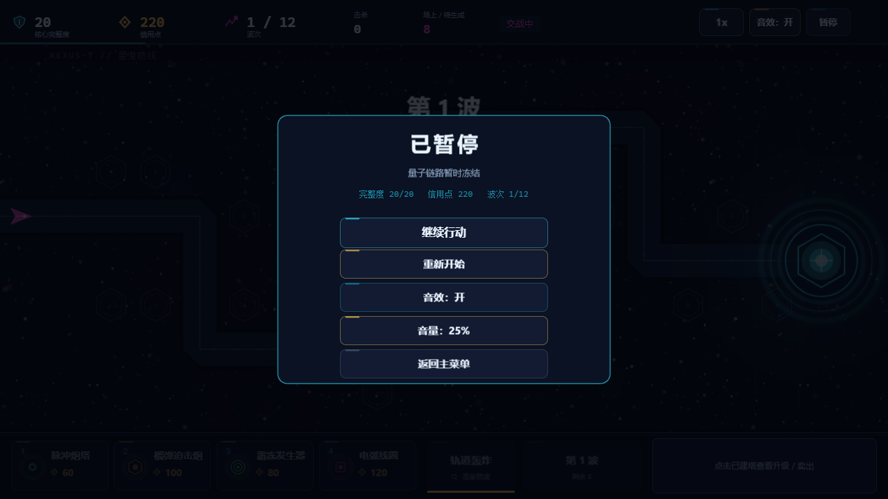
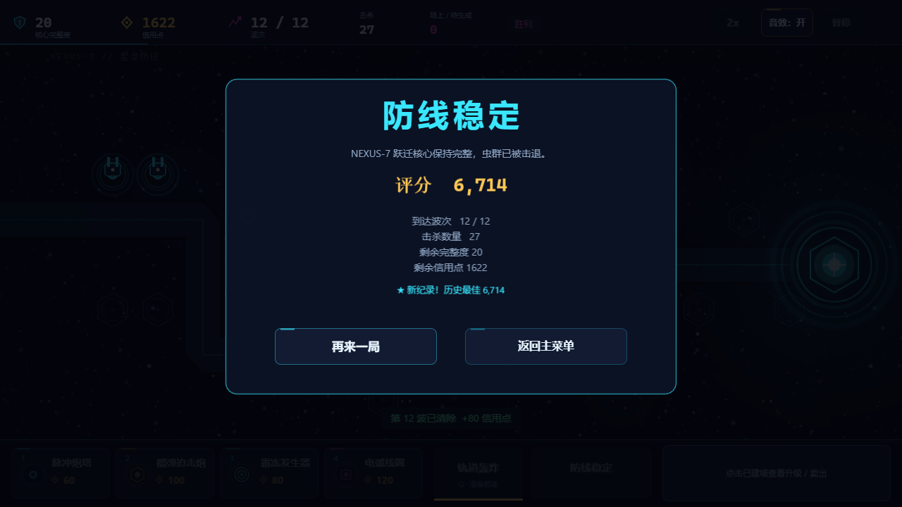
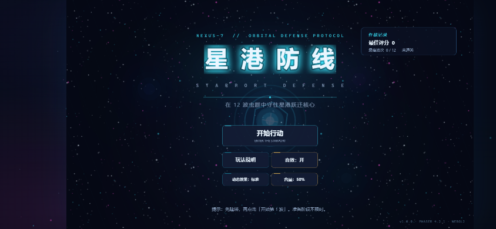
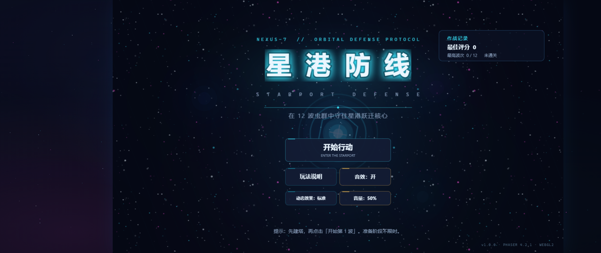
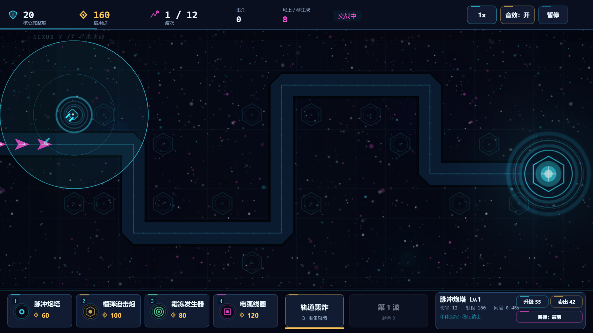

# 星港防线 · Starport Defense

用 **Phaser 4.2.1** 构建的浏览器端单机塔防小游戏，已可完整游玩。

> 在 12 波异星虫群的进攻中，用 4 类炮塔、升级与轨道轰炸，守住 NEXUS-7 星港的跃迁核心。



## 快速开始

环境：Node.js 20.19+ 或 22.12+（Vite 8 要求；本项目在 Node 22 下开发），现代支持 WebGL2 的浏览器。

```bash
npm install
npm run dev
```

打开终端输出的本地地址（默认 `http://127.0.0.1:5173/`）。

生产构建与预览：

```bash
npm run build
npm run preview
```

> 构建产物在 `dist/`，可部署到任意静态站点。游戏运行期无第三方网络请求、无后端。

## 已实现内容

- **单局完整循环**：1 张 NEXUS-7 星港地图、16 个建造位、12 波敌人、最终 Boss，单局约 10–15 分钟。
- **4 座防御塔**：脉冲炮塔（单体追踪）、榴弹迫击炮（范围）、霜冻发生器（减速）、电弧线圈（连锁），各 3 级升级与卖出返还。
- **5 类敌人 + 精英 + Boss**：侦察虫、疾行虫、装甲虫、分裂虫、碎片；护甲、减速抗性、分裂、Boss 半血狂暴。
- **主动技能**：轨道轰炸，0.4 秒预警、200 点无视护甲范围伤害、30 秒冷却。
- **操作与节奏**：鼠标/键盘建造；1x–5x 速度；暂停；波间准备不限时；波次中也可建造/升级/卖出。
- **下一波预览**：准备阶段显示下一波敌人构成与清波奖励，开波后自动隐藏。
- **设置**：音效开关、音量（100% / 75% / 50% / 25% / 0%）、减少动态效果；菜单与暂停面板均可调整，状态持久化。
- **目标优先级**：每座塔可切换“最前 / 最强 / 最近”。
- **反馈与表现**：程序化星空/星云、炮口与弹道、命中/爆炸粒子、漏怪红屏与震屏、Boss 血条、波次横幅、信用点飘字。
- **全屏环境背景**：Phaser 画布保持 16:9，画布外的 letterbox 区域由独立 Canvas 星空层填充，页面整体更沉浸。
- **存档**：最佳评分、最高波次、是否通关、音效与“减少动态效果”设置写入 `localStorage`；存储不可用时自动降级为内存状态。
- **音效**：Web Audio 合成，无外部音频文件；静音开关持久化。
- **适配**：1280×720 等比缩放；移动端横屏可用（P1）；竖屏显示横屏提示，并自动暂停游戏。
- **背景满屏**：非 16:9 窗口、手机横屏或超宽屏下，游戏画面保持 16:9 居中，两侧/上下由动态星空与星云背景铺满，无黑边、不拉伸、不裁切。
- **高分辨率渲染**：内部按 2560×1440 渲染并配合 2x 文本纹理，再等比缩放到窗口，改善 1080p/高 DPI 屏幕上的文字与线条模糊；鼠标/触摸坐标经过相机换算，交互不受影响。
- **工程保障**：TypeScript strict、Vitest 单元测试、生产构建、无控制台错误。

## 操作

| 操作 | 键鼠 |
| --- | --- |
| 选择防御塔 | 点击底部塔卡 / `1`–`4` |
| 放置防御塔 | 点击战场六边形建造位 |
| 取消放置 / 关闭面板 | 右键 / `Esc` |
| 选中已建塔 | 点击塔 |
| 升级 / 卖出 | 点击面板按钮 / `U` / `S` |
| 开始下一波 | 点击“开始第 N 波” / `Enter` |
| 轨道轰炸 | 点击技能按钮 / `Q`，再点击战场 |
| 暂停 / 继续 | `Space` / `Esc` / 点击“暂停” |
| 切换 1x–5x | `F` / 点击速度按钮循环切换 |

## 游戏截图

| 战斗 | Boss 波 |
| --- | --- |
|  |  |

| 暂停（可调音量） | 胜利结算 |
| --- | --- |
|  |  |

| 手机横屏：背景铺满 | 超宽屏：背景铺满 |
| --- | --- |
|  |  |

| 1920×1080：2x 内部渲染 | 高分辨率菜单 |
| --- | --- |
|  |  |

更多截图与验收数据见 `artifacts/`。

## 技术结构

- **引擎**：Phaser 4.2.1（锁定版本，WebGL 渲染、统一 Filter API）
- **语言/构建**：TypeScript（strict）+ Vite 8
- **测试**：Vitest
- **核心架构**：
  - `src/domain/`：纯 TypeScript 战斗/索敌/路径/计分规则，不依赖 Phaser，可直接单元测试。
  - `src/data/`：塔、敌人、波次、关卡配置数据。
  - `src/game/`：固定 60 Hz 模拟常量与运行时类型。
  - `src/scenes/`：Boot / Menu / Game / UI 场景；UI 与模拟通过类型化 EventBus 通信。
  - `src/render/`：启动时程序化生成纹理、背景、粒子/震屏效果。
- **关键设计**：固定步长模拟、配置驱动、全部资源程序化生成、无物理引擎、UI 独立场景、暂停时冻结场景并复位累积器。

详细方案见：

- [需求规格说明](docs/01-requirements.md)
- [技术方案与实施计划](docs/02-technical-design.md)
- [实施与验收报告](docs/03-implementation-report.md)

## 验证状态

- `npm run typecheck` 通过。
- `npm test`：**30** 个单元测试通过（6 个测试文件）。
- `npm run build` 通过。
- 生产构建 `dist` 经 `vite preview` 在 Chrome 中冒烟通过：Canvas 1280×720、无黑屏、无错误、无失败请求（`artifacts/prod-smoke.json`）。
- 真实浏览器验证：菜单/帮助、建塔、4 种塔攻击路径、升级/卖出、下一波预览、暂停/恢复、音量控制、1x–5x 速度、Boss 血条、真实胜利、真实漏怪失败、分裂虫碎片、重开、返回菜单、成绩持久化、移动横屏/竖屏自动暂停、844×390 与 2560×1080 背景满屏、2x 内部渲染下的 UI 命中与文字清晰度。
- 浏览器控制台无错误、无第三方网络请求。
- 硬件 WebGL（Intel Arc Pro 140T / ANGLE D3D11）压力探针：1x 渲染 30/60 个同屏敌人下帧率高于 60 fps；2x 内部渲染下 60 个敌人约 84 fps；详见 `artifacts/hidpi-perf.json`。
- 验收记录与截图：`artifacts/final-verification.json`、`artifacts/p1-final-verification.json`、`artifacts/bgfill-verification.json`、`artifacts/sharpness-verification.json`、`artifacts/prod-sharpness.json`、`artifacts/speed-verification.json`、`artifacts/screenshots/`。

## 已知限制 / 后续可做

- 移动端为 P1：游戏本体保持 16:9，超宽屏两侧由动态背景填充；触控手感尚未做深度打磨。
- 只有一个关卡与 12 波内容；无尽模式、第二张地图、成就等属于 P2。
- 无背景音乐；音效为合成音色。
- 无中局存档；刷新页面会结束当前对局。
- 数值为初版基线，建议在更多实机试玩后继续微调难度曲线。

## 许可与资源

- 引擎：[Phaser](https://phaser.io/)（MIT）。
- 本项目的代码、程序化图形与合成音效均为项目内生成，不包含第三方美术/音频素材；使用系统字体。
