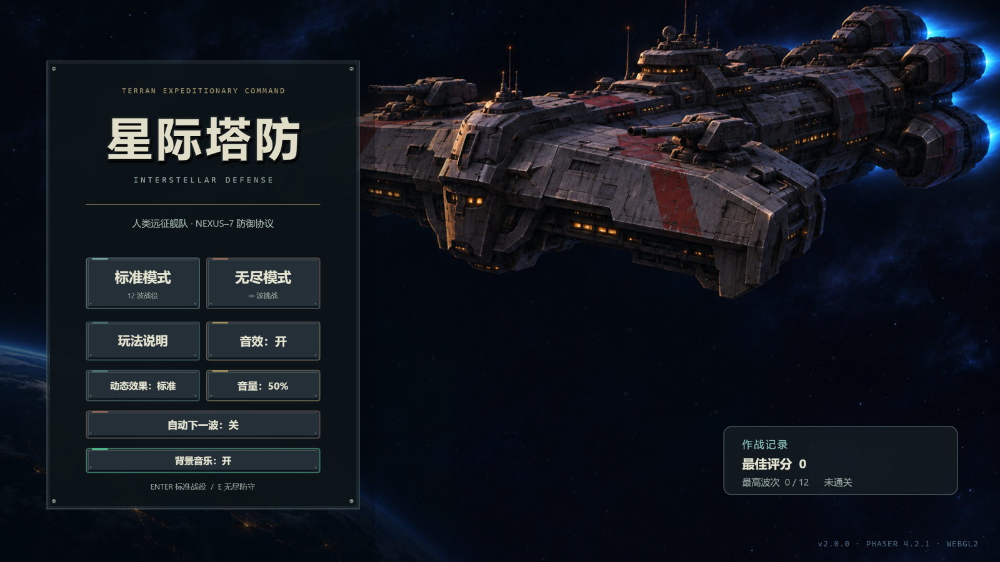
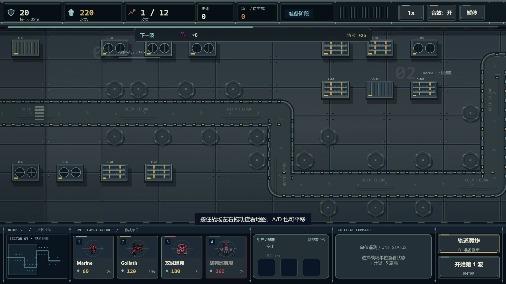
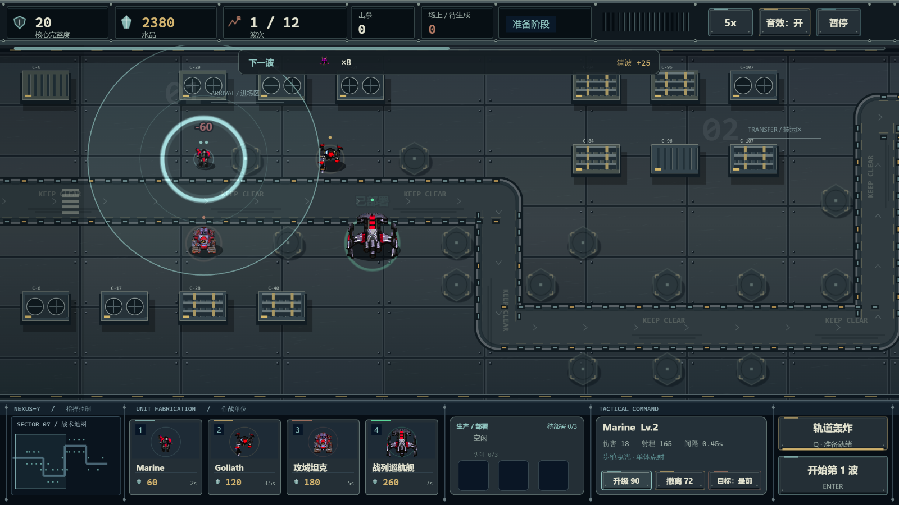
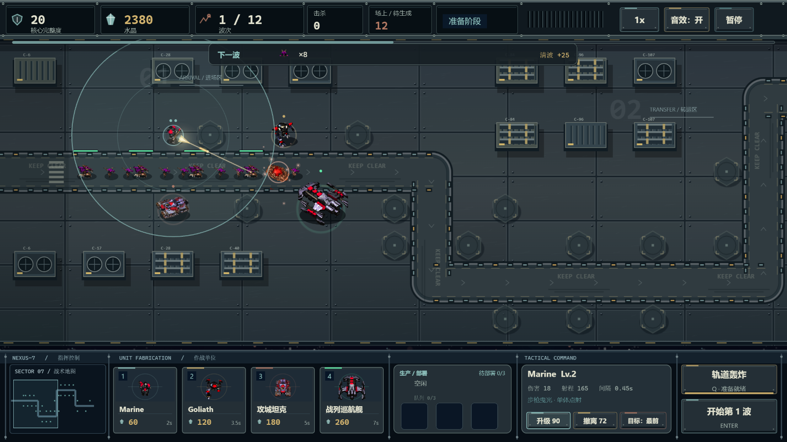
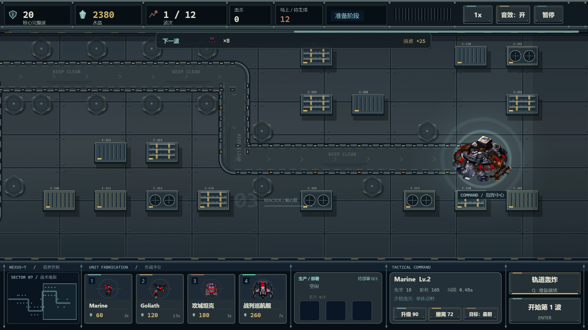
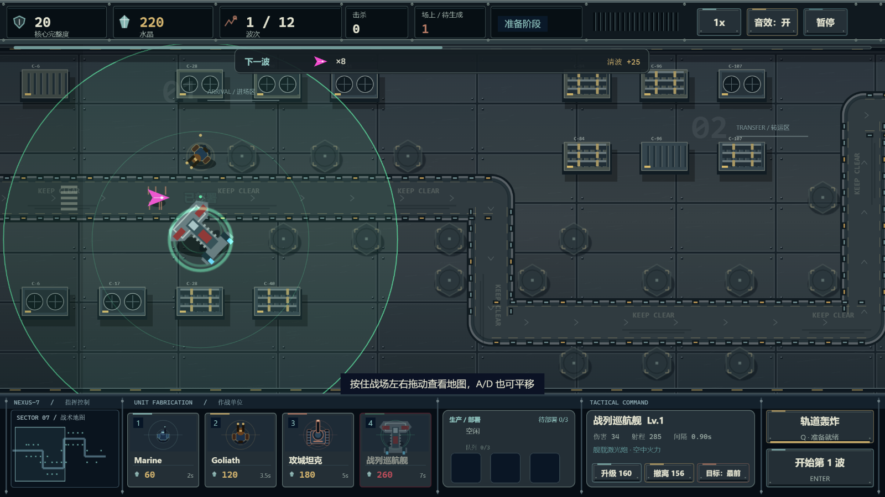
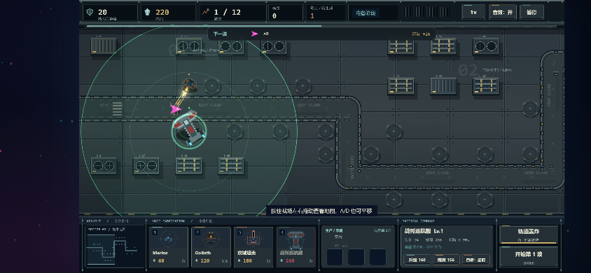

# 星际塔防 · Interstellar Defense

用 **Phaser 4.2.1** 构建的浏览器端单机塔防小游戏，已可完整游玩。

> 在 12 波虫族的进攻中，用水晶制造人族作战人员与装甲，拖放到部署点，升级装备并守住 NEXUS-7 星港指挥中心。



## 快速开始

环境：Node.js 20.19+ 或 22.12+（Vite 8 要求；本项目在 Node 22 下开发），现代支持 WebGL2 的浏览器。

```bash
npm install
npm run dev
```

打开终端输出的本地地址（默认 `http://127.0.0.1:5173/`）。

生产构建与预览：

```bash
npm run build
npm run preview
```

> 构建产物在 `dist/`，可部署到任意静态站点。游戏运行期无第三方网络请求、无后端。

## 已实现内容

- **单局完整循环**：1 张横向 2 倍长度的 NEXUS-7 星港地图（2560×720 世界、36×8 格、32 个部署点）、12 波敌人、最终 Boss，单局约 10–15 分钟。
- **横向拖动视角**：地图世界宽 2560、视口 1280；按住战场左右拖动或按 A/D / ←/→ 平移，顶部显示视角位置条。
- **人族作战单位**：四个兵种——**Marine**（步枪曳光）、**Goliath**（双管自动炮）、**攻城坦克**（范围重炮）与**战列巡航舰 Battlecruiser**（舰载激光炮），各 3 级升级。
- **工业星港视觉**：高分辨率装甲甲板、跑道肩线/方向标/灯带、管道/风扇/货箱；底部 150px 指挥台含可点击战术小地图、四张制造卡、生产部署、单位遥测与指挥操作。
- **体型与步态**：统一 Marine < Goliath < 坦克 < 战列巡航舰的世界体型，升级不放大；本地包提供 16 方向、7/9 帧虫族步态，由移动距离驱动并随暂停冻结。缺包使用程序化关节动作。
- **制造系统**：使用**水晶**申请制造；单生产线、队列 3、生产时间 2s / 3.5s / 5s / 7s；完成后进入待部署区。
- **拖放部署**：从待部署区拖动单位到六边形部署点；也支持“先点单位再点部署点”，波次中也可部署。
- **选中与升级**：点击已部署单位查看属性、升级或撤离（返还 60% 已投入水晶）；可切换目标优先级。
- **专属语音**：四兵种选中、部署、升级、撤离分别播放原创中文无线电语音；受静音和音量控制。
- **5 类虫族敌人 + 精英 + Boss**：跳虫、迅捷跳虫、刺蛇、潜伏者、分裂幼虫；护甲、分裂、Boss 半血狂暴。本地素材包存在时使用虫族像素帧（Zergling / Hydralisk / Lurker / Ultralisk）。
- **主动技能**：轨道轰炸，0.4 秒预警、200 点无视护甲范围伤害、30 秒冷却。
- **无尽模式**：标准 12 波战役之外，可从主菜单进入无限波；敌人数量与血量持续提高。
- **操作与节奏**：鼠标/键盘；1x–5x 速度；暂停；波间准备不限时。
- **下一波预览**：准备阶段显示下一波敌人构成与清波奖励，开波后自动隐藏。
- **自动下一波**：可在主菜单或暂停面板开启；清波后 3 秒自动开下一波，显示倒计时，也可点击按钮立即开始。
- **设置**：音效开关、音量（100% / 75% / 50% / 25% / 0%）、减少动态效果、自动下一波；菜单与暂停面板均可调整，状态持久化。
- **可选星际素材本地包**：Codex 整理的机枪兵/攻城坦克像素帧、红色爆炸动画、按钮/单位/攻击/升级/击杀/胜负音效，可在本地接入；缺包时自动回退程序化画面与合成音效。素材不提交、不随公开仓库分发。
- **反馈与表现**：程序化星空/星云、枪口与弹道、步枪曳光、双管火力、重炮炮口冲击、战列舰激光束、命中/爆炸粒子、漏怪红屏与震屏、Boss 血条、波次横幅、水晶飘字；本地素材包接入后使用星际像素单位与爆炸序列。
- **全屏环境背景**：Phaser 画布保持 16:9，画布外的 letterbox 区域由独立 Canvas 星空层填充。
- **高分辨率渲染**：内部按 2560×1440 渲染并配合 2x 文本纹理，再等比缩放到窗口，改善 1080p/高 DPI 屏幕上的文字与线条模糊；鼠标/触摸坐标经过相机换算。
- **存档**：最佳评分、最高波次、是否通关、音效、动态效果、自动下一波设置写入 `localStorage`；存储不可用时自动降级为内存状态。
- **工程保障**：TypeScript strict、Vitest 单元测试、生产构建、无控制台错误。

## 操作

| 操作 | 键鼠 |
| --- | --- |
| 开始标准模式 / 无尽模式 | 点击“标准模式 / 无尽模式” / `Enter` / `E` |
| 申请制造 Marine / Goliath / 坦克 / 战列巡航舰 | 点击制造卡 / `1` / `2` / `3` / `4` |
| 部署单位 | 拖动待部署单位到部署点；或点击单位再点部署点 |
| 平移地图 | 按住战场左右拖动 / `A` / `D` / `←` / `→` |
| 取消部署 / 关闭面板 | 右键 / `Esc` |
| 选中已部署单位 | 点击单位 |
| 升级 / 撤离 | 点击面板按钮 / `U` / `S` |
| 开始下一波 | 点击“开始第 N 波” / `Enter` |
| 轨道轰炸 | 点击技能按钮 / `Q`，再点击战场 |
| 暂停 / 继续 | `Space` / `Esc` / 点击“暂停” |
| 切换 1x–5x | `F` / 点击速度按钮循环切换 |

## 游戏截图

| 新指挥台与工业甲板 | 四兵种尺寸比例 |
| --- | --- |
|  |  |

| 曳光与舰载激光炮战斗 | 右侧核心战区 |
| --- | --- |
|  |  |

| 无本地素材包 | 手机横屏 |
| --- | --- |
|  |  |

更多截图与验收数据见 `artifacts/`。

## 技术结构

- **引擎**：Phaser 4.2.1（锁定版本，WebGL 渲染）
- **语言/构建**：TypeScript（strict）+ Vite 8
- **测试**：Vitest
- **核心架构**：
  - `src/domain/`：纯 TypeScript 战斗/索敌/路径/计分规则，不依赖 Phaser。
  - `src/data/`：作战单位、敌人、波次、关卡配置数据；关卡世界 2560×720，相机水平平移。
  - `src/game/`：固定 60 Hz 模拟常量与运行时类型。
  - `src/scenes/`：Boot / Menu / Game / UI 场景；UI 与模拟通过类型化 EventBus 通信。
  - `src/ui/`：UnitCard、ProductionTray、Button 等界面组件。
  - `src/render/`：启动时程序化生成纹理、工业甲板、武器/粒子/震屏效果。
- **关键设计**：固定步长模拟、配置驱动、程序化生成图形、无物理引擎、UI 独立场景、暂停时冻结场景并复位累积器。

详细方案见：

- [需求管理流程与登记表](docs/00-requirement-process.md)
- [星际素材本地接入需求](docs/07-starcraft-asset-integration.md)
- [虫族敌人接入需求](docs/08-zerg-enemy-integration.md)
- [地图横向扩展与拖动视角](docs/06-map-horizontal-expansion.md)
- [人族单位玩法需求（v2）](docs/04-unit-gameplay-redesign.md)
- [需求规格说明（v1 基线）](docs/01-requirements.md)
- [技术方案与实施计划](docs/02-technical-design.md)
- [实施与验收报告](docs/03-implementation-report.md)
- [项目协作规则（AGENTS.md）](AGENTS.md)

## 验证状态

- `npm run typecheck` 通过。
- `npm test`：**33** 个单元测试通过（7 个测试文件）。
- `npm run build` 通过。
- 本轮真实浏览器验证：四兵种制造/拖放部署、非法落点保留单位、升级尺寸稳定、16方向步态和暂停、小地图平移、缺包回退。此前版本的12波战役与无尽验收属于历史记录，本轮未重跑完整数值平衡。
- 本地星际素材包验证：`sc-marine` / `sc-tank` / `sc-explosion` 加载，卡片/待部署/部署单位使用 SC 纹理，选中/攻击/击杀/胜利/失败触发对应 WAV，爆炸动画帧正常播放；虫族敌人使用 Zergling/Hydralisk/Lurker/Ultralisk 像素帧，Boss 为雷兽；移除素材包后程序化 fallback 正常启动。
- 语音资源：12 段原创中文无线电台词（3 兵种 × 选中/部署/升级/撤离），本机 TTS 生成；本地星际包存在时，机枪兵/坦克的选中使用 SC selected 音效，缺包时回退 TTS。
- 浏览器控制台无错误、无第三方网络请求。
- 硬件 WebGL（Intel Arc Pro 140T / ANGLE D3D11）压力探针：2x 内部渲染下 60 个敌人约 84 fps；详见 `artifacts/hidpi-perf.json`。
- 验收记录与截图：`artifacts/unit-gameplay-verification.json`、`artifacts/unit-upgrade-verification.json`、`artifacts/firebat-verification.json`、`artifacts/tank-verification.json`、`artifacts/map-pan-verification.json`、`artifacts/map-runtime-verification.json`、`artifacts/starcraft-pack-verification.json`、`artifacts/starcraft-pack-final-verification.json`、`artifacts/sc-pack-fallback-verification.json`、`artifacts/zerg-enemy-verification.json`、`artifacts/zerg-fallback-verification.json`、`artifacts/screenshots/`。

## 已知限制 / 后续可做

- 第一版单位**不会被敌人攻击**，也没有单位生命/维修机制；这是已确认的设计范围。
- 移动端为 P1：游戏本体保持 16:9，超宽屏两侧由动态背景填充；触控手感尚未做深度打磨。
- 标准模式 12 波 + 无尽模式；数值为初版基线，建议真人试玩后继续调参。
- 原创循环背景音乐；音效与语音为项目内合成/生成资源。
- 无中局存档；刷新页面会结束当前对局。

## 许可与资源

- 引擎：[Phaser](https://phaser.io/)（MIT）。
- 游戏基础美术、程序化图形、合成音效与中文语音均为项目内生成；语音使用本机 TTS 生成后以 WAV 打包。
- 可选的星际素材本地包来自 Codex 整理的第三方参考素材，权利归 Blizzard 等相应权利人所有；仅用于本地试玩/开发，**不提交、不随公开仓库或部署产物分发**。公开部署前应移除 `public/assets/sc-local/` 或替换为已授权资源。
- 本地准备方式：`python scripts/stage-starcraft-pack.py`；无素材包时游戏自动使用程序化 fallback。
- 不使用、不复制《星际争霸》原版代码、地图或过场内容。

## 本轮视觉升级验收（2026-11-07）

需求与范围见 [09-visual-command-overhaul.md](docs/09-visual-command-overhaul.md)。类型检查、33 项单测、生产构建通过；独立 Chrome 验证四兵种制造/拖放、非法落点保留单位、升级尺寸稳定、步态与暂停、小地图平移、无本地包 fallback 和 844×390 横屏截图，脚本异常 0。记录见 [visual-overhaul-verification.json](artifacts/visual-overhaul-verification.json)。本轮未重新跑完整 12 波平衡验收。

本地包重新生成：`python scripts/stage-starcraft-pack.py`（需要 Pillow；阶段工具会读取社区仓库的图集坐标，运行期无第三方请求）。新增 `scripts/stage-motion-pack.py` 处理方向与步态，源文件不变。


## 人类机械科技风与音乐（2026-11-07）

游戏名已统一为“星际塔防”；第四兵种更正为人类战列巡航舰 Battlecruiser（舰载激光炮）。菜单使用原创生成的深空战列舰插画，上下控制台统一为金属装甲/铆钉/凹槽式界面。本地可选包中基地使用人族指挥中心，缺包回退工业建筑。

新增原创 36.92 秒循环太空军事氛围音乐：首次点击后播放，菜单和暂停面板有独立“背景音乐”开关，自动保存，跟随总音量与静音，页面隐藏时暂停。音乐由 scripts/generate-orbit-music.py 合成，位于 public/audio/music/terran-orbit.wav；不是游戏原声。

需求见 docs/10-terran-interface-style.md。菜单截图 artifacts/screenshots/116-terran-menu.png；完整基础交互和音乐状态验证见 artifacts/visual-overhaul-verification.json。
